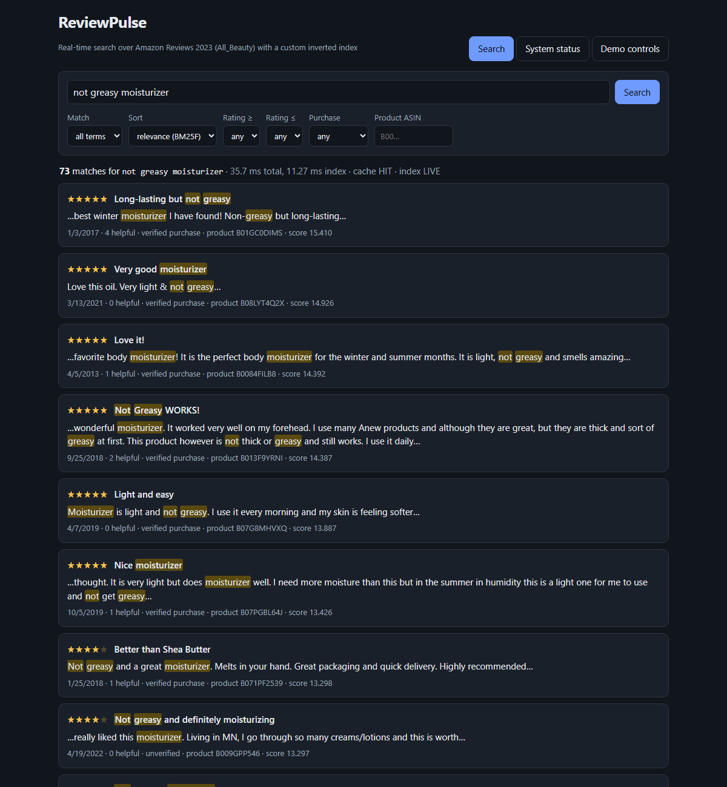
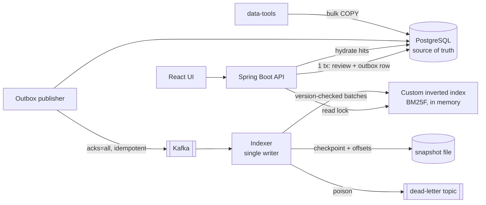

# ReviewPulse

Real-time product-review search over **real Amazon Reviews 2023 data** (All_Beauty, 701K reviews), built
around a **custom inverted index written from scratch in Java**: no Lucene, Elasticsearch, Solr or
PostgreSQL full-text search. Writes go to PostgreSQL through a **transactional outbox**, flow through
**Kafka**, and are applied by a single-writer indexer with **version-checked, idempotent** updates,
**checkpointed persistence** and **crash recovery**.



## Highlights (measured; see [benchmark results](docs/benchmark-results.md))

* **Index-only query latency at 100K reviews:** p50 0.07 ms, p95 2.9 ms. That is **95× to over 1,000×
  faster** than a naive PostgreSQL word-boundary scan over the same rows and queries, which takes
  12–267 ms at p50.
* **End-to-end `GET /api/search` at 50 req/s per scenario:** p95 5–9 ms, including hydration from
  PostgreSQL. 0 errors.
* **Write → searchable:** p50 119 ms, p95 266 ms through outbox → Kafka → index. 200/200 within 10 s.
* **Replayed live traffic:** ~420 events/s end to end with 8 writers. Duplicate and out-of-order events
  were injected, and the index still matched PostgreSQL exactly afterwards (131,264 = 131,264).
* **Recovery:** restart from a 19.6 MB checkpoint in 825 ms, vs 5.3 s for a full rebuild.
* **Measured, then disabled by default:** the Redis cache was slower than the in-process index at this
  scale.

## Architecture



More: [architecture](docs/architecture.md) · [search index internals](docs/search-index.md) ·
[consistency guarantees](docs/consistency.md) · [security & trust boundary](docs/security.md) ·
[dataset](docs/dataset.md) · [benchmark methodology](docs/benchmark-methodology.md) ·
[interview notes](docs/interview-prep.md) · [decisions](docs/decisions/)

## What's implemented

| Area | Implementation |
|---|---|
| Tokenizer | Unicode letters/digits, NFKD diacritic folding, apostrophe joining, negation-preserving stop words, offsets for highlighting |
| Index | docId-sorted append-only posting lists (packed title/body tf), column-store doc table, exact df/length stats, lazy deletion + compaction |
| Queries | AND via leapfrog intersection with galloping search; OR via heap k-way merge; product/rating/verified filters; top-K heap; keyset cursors; time budget |
| Ranking | BM25F (k1 1.2, b 0.75, title ×2), separate relevance/recency/helpfulness total orders |
| Writes | optimistic versions (`409` on conflict), outbox row in the same transaction |
| Events | fat events (full state per version) → duplicates and late older versions are no-ops; DLT for poison |
| Persistence | CRC-checked binary checkpoint + Kafka offsets, atomic rename; validated on restart; rebuild fallback |
| Ops | health UP/DEGRADED/DOWN per component, metrics summary + Prometheus, rate limits, body limits, admin token |
| Demo | React search/status/demo UI; replay simulator with rate control and duplicate/out-of-order injection |

## Run it locally

Requirements: Docker Desktop, JDK 21, Node ≥ 20.19 (UI only), Python 3.10+ (data tools).
Everything binds to `127.0.0.1`.

```bash
cp .env.example .env                      # set REVIEWPULSE_ADMIN_TOKEN
docker compose up -d                      # PostgreSQL :15432, Kafka :9092, Redis :6379

# 1. Backend (creates the schema, builds the index, consumes Kafka)
cd backend && ./mvnw spring-boot:run      # http://127.0.0.1:8080, Swagger UI at /api/docs/ui

# 2. Real data (~139 MB download, verified by SHA-256; kept out of Git)
cd data-tools
python -m venv .venv && .venv/Scripts/pip install -r requirements.txt   # .venv/bin/pip on Linux/macOS
.venv/Scripts/python prepare_dataset.py download
.venv/Scripts/python prepare_dataset.py import --limit 100000           # idempotent; index rebuilds automatically
.venv/Scripts/python prepare_dataset.py export-replay --offset 100000 --limit 5000 --name beauty-live-5k

# 3. UI
cd frontend && npm install && npm run dev # http://127.0.0.1:5173
```

Try it:

```bash
curl "http://127.0.0.1:8080/api/search?q=not+greasy+moisturizer&ratingMin=4&sort=helpfulness"
curl -X POST http://127.0.0.1:8080/api/reviews -H 'Content-Type: application/json' \
     -d '{"parentAsin":"B0DEMO0001","title":"Zesty test","body":"brand new words","rating":5}'
curl http://127.0.0.1:8080/api/health
```

### API

| Method | Path | Notes |
|---|---|---|
| GET | `/api/search` | `q`, `operator` (AND/OR), `ratingMin/Max`, `parentAsin`, `verifiedPurchase`, `sort` (relevance/recency/helpfulness), `pageSize` ≤ 50, `cursor` |
| GET | `/api/reviews/{id}` | includes `version`, `indexedVersion`, `searchable` |
| POST / PUT / DELETE | `/api/reviews[/{id}]` | PUT/DELETE require `expectedVersion`; 2xx = committed, indexing is async |
| POST | `/api/reviews/{id}/helpful` | metadata-only index update |
| GET | `/api/health`, `/api/metrics/summary` | also `/actuator/prometheus` |
| POST/GET | `/api/admin/reindex`, `/snapshot`, `/index-status`, `/index-verify`, `/replay/*` | `X-Admin-Token` required |

Review ids are strings in JSON: dataset ids exceed 2^53 and would lose precision as JavaScript numbers.

## Tests

```bash
cd backend && ./mvnw verify      # 97 unit tests + 27 integration tests (Testcontainers: PostgreSQL, Kafka, Redis)
                                 # merged coverage report: backend/target/site/jacoco-merged/index.html
cd data-tools && .venv/Scripts/python -m pytest -q    # 26 tests (one uses the local PostgreSQL)
cd frontend && npm run build     # strict TypeScript + production build
```

Coverage (unit + integration, JaCoCo, last run): **88% of instructions, 77% of branches**. The search
engine packages are at 97–100% instructions; the weakest areas are the metrics-summary service (48%)
and the outbox publisher's non-retriable failure branches.

Highlights of what is tested:

* Search results are compared against an **independent brute-force implementation** over randomized
  corpora with inserts, updates, deletes, duplicates and stale events, before and after compaction.
* Testcontainers ITs cover create → searchable, old terms disappearing after an update, deletes,
  duplicate and out-of-order Kafka delivery, a poison message reaching the DLT, rollback publishing
  nothing, concurrent updates (exactly one winner) and concurrent votes.
* Rebuild during writes, crash after checkpoint (older snapshot + lost memory), a corrupt checkpoint,
  failing checkpoints never advancing Kafka offsets, Kafka/PostgreSQL/Redis outages (`docker pause`),
  and cache invalidation.

## Limitations (honest list)

* Single node: one in-memory index per process; no sharding or replication (design notes in
  [interview-prep](docs/interview-prep.md)).
* Search is eventually consistent; no read-your-writes in search; cursors can shift if the index changes
  between pages ([consistency](docs/consistency.md)).
* Checkpoints pause indexing about 1 s at 100K+ reviews (causes p99 freshness spikes); there is no
  background/incremental checkpointing.
* No stemming, no phrase queries, no CJK segmentation; BM25 parameters are defaults, not tuned.
* The full ~700K benchmark was not run (disk space on the dev machine); 10K and 100K were.
* No frontend unit/E2E tests. The UI was verified by building it and by screenshots against the live
  backend.
* Admin auth is a shared token for local demos, not user authentication.
* Benchmarks come from one busy laptop; tails vary between runs.

## Dataset & attribution

Amazon Reviews 2023 by McAuley Lab (Hou et al., *Bridging Language and Items for Retrieval and
Recommendation*, arXiv:2403.03952). The dataset card declares no license; this project uses the data for
non-commercial research and education, never commits or redistributes it, and does not store reviewer
ids. See [docs/dataset.md](docs/dataset.md).
