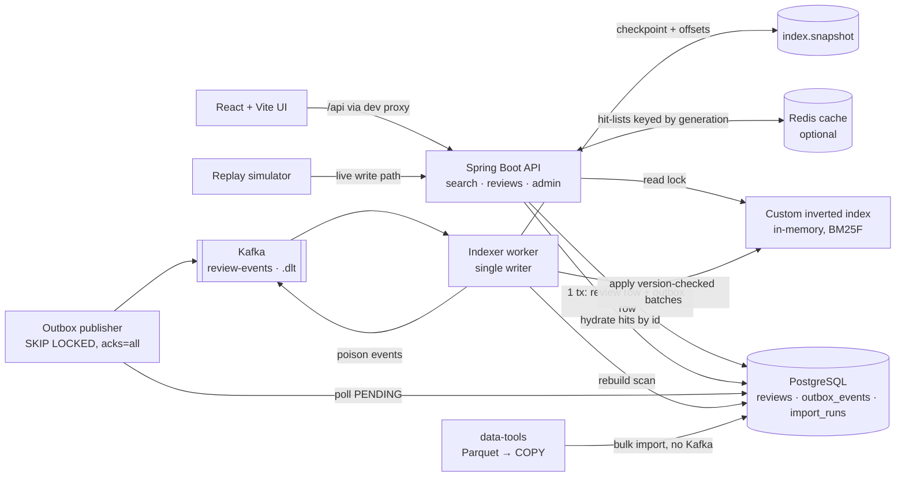

# Architecture

One Spring Boot application (a modular monolith) with background workers, plus PostgreSQL, Kafka and Redis
in Docker Compose. Logical components are packages, not microservices.

## Packages (`backend/src/main/java/com/reviewpulse`)

| Package | Responsibility |
|---|---|
| `search.tokenizer`, `search.postings`, `search.index`, `search.ranking`, `search.query`, `search.highlight` | The search engine. Plain Java, no framework. |
| `search` (root) | Index lifecycle glue: status, PostgreSQL rebuild, snapshot store, verification, search use case |
| `reviews` | Authoritative data access (`JdbcClient`, explicit SQL) and the transactional write service |
| `outbox` | Outbox repository and publisher |
| `events` | Event schema/codec, Kafka topics, indexer worker, checkpoints, dead-letter publisher |
| `caching` | Redis result cache with fail-fast bypass |
| `ingestion` | Replay simulator |
| `observability` | Indexer progress counters, metrics summary |
| `api` | Controllers, error mapping, admin-token and rate-limit filters |
| `config` | Typed configuration and wiring |

## Main flows

**Search.** Validate → tokenize → (cache lookup) → rank under the index read lock → hydrate the top-K ids
from PostgreSQL (drop deleted, count them) → highlight → envelope with index state, lag and timings.

**Write.** One transaction: conditional `UPDATE … RETURNING` + outbox insert. 2xx means committed, not
searchable. The publisher and the indexer make it searchable asynchronously (`docs/consistency.md`).

**Bulk bootstrap.** `data-tools` streams Parquet into PostgreSQL with `COPY` + `ON CONFLICT DO NOTHING`.
The indexer sees the new `import_runs` row and rebuilds from PostgreSQL. 700K historical rows are never
pushed through HTTP or Kafka.

**Startup.** Restore the checkpoint if valid, else rebuild; then consume Kafka from the checkpoint/rebuild
offsets. Search returns 503 only until the first index exists.

## Threads

| Thread | Work |
|---|---|
| Tomcat (virtual threads) | HTTP requests; index reads under the shared read lock |
| `indexer` | Kafka poll, batch apply, rebuilds, checkpoints, lag refresh, bulk-import checks |
| Spring scheduler | Outbox publisher (100 ms), outbox purge (hourly), metrics sampler (1 s) |
| `replay` | Simulator pacing loop (only while a replay runs) |

## Resource footprint (this machine, 99,688 reviews)

The index rebuilds from PostgreSQL in about 4.6 s and the checkpoint is 16.4 MB. At the full 694K reviews:
about 425 MB of heap, a 104 MB checkpoint, and a 21 s rebuild (28 s inside the 1.5 GB backend
container). Per-size numbers are in `docs/benchmark-results.md`. Compose limits: PostgreSQL 768 MB, Kafka 768 MB
(384 MB heap), Redis 128 MB (64 MB maxmemory, LRU).
